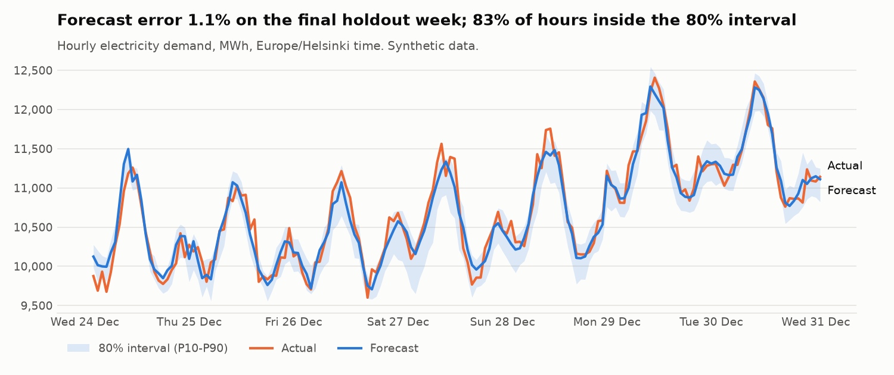
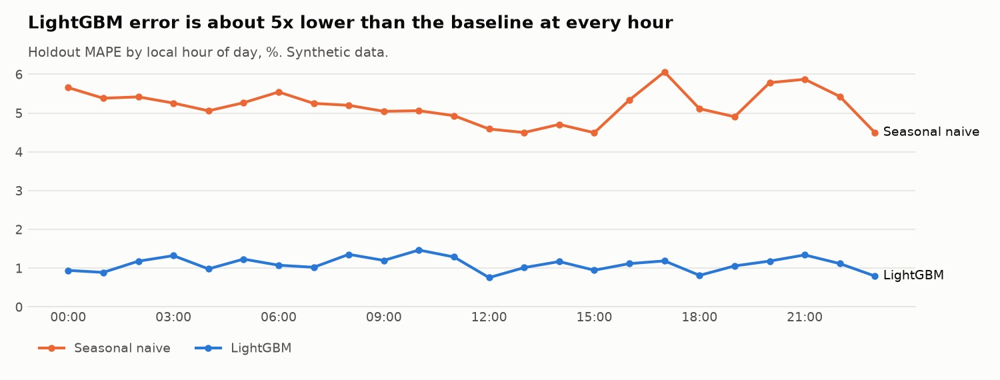

# Finnish Energy Demand Forecasting — an end-to-end MLOps loop


Day-ahead forecasts of hourly electricity consumption in Finland, with **calibrated 80% prediction
intervals**, built as a small but complete production loop:
**ingest → features → train → evaluate → promote → serve → monitor**, run daily by Airflow.

**What this project shows**

- A model that is measured honestly: time-series validation, a baseline it must beat, and a
  holdout it never sees.
- Intervals you can trust: raw quantile models covered 71% of hours; conformal calibration brings
  it to 83% for a nominal 80%.
- Production habits: model registry with a tested promotion rule, an API with typed contracts,
  drift and error monitoring, idempotent ingestion, CI with lint, types, tests and coverage.



## Problem

An energy retailer buys tomorrow's electricity today, hour by hour. Every percent of forecast error
costs money on the balancing market, and a buyer needs a range, not only a number. This project
forecasts the next 24 hours of Finnish demand with an 80% interval, and keeps itself healthy: it
retrains daily, promotes a new model only when it is measurably better, and raises an alert when
the error grows.

## Architecture

```mermaid
flowchart LR
    F[Fingrid Open Data<br/>hourly consumption] --> I
    W[FMI open data<br/>temperature] --> I
    I[ingest<br/>idempotent upsert] --> S[(parquet store)]
    S --> FE[features<br/>lags ≥ 24h, calendar,<br/>FI holidays, heating degrees]
    FE --> T[train<br/>LightGBM + time-series CV<br/>+ quantiles + conformal]
    T --> M[(MLflow<br/>runs + registry)]
    M -->|beats baseline<br/>and champion?| P{promote}
    P -->|yes| C[@champion alias]
    C --> API[FastAPI<br/>POST /forecast]
    S --> MON[monitor<br/>PSI drift + daily MAPE]
    C --> MON
    A[Airflow DAG<br/>daily 06:00 UTC] -.runs.-> I & T & MON
```

Step-by-step explanation of the code: **[docs/how-it-works.md](docs/how-it-works.md)**.
Why each choice was made: **[docs/decisions.md](docs/decisions.md)**.

## Quick start

```bash
# Option A: Docker (MLflow UI on :5000, API docs on :8000/docs)
make up

# Option B: local Python 3.11+
python -m venv .venv && source .venv/bin/activate
make install
make demo            # synthetic data -> train -> monitor -> API on :8000
```

```bash
curl -X POST localhost:8000/forecast -H 'content-type: application/json' -d '{"date": "2025-12-31"}'
```

```json
{"date": "2025-12-31", "model_uri": "models:/fi-energy-demand@champion",
 "hours": [{"timestamp": "2025-12-30T22:00:00+00:00", "forecast_mwh": 10995.2,
            "p10_mwh": 10695.9, "p90_mwh": 11111.5}, "..."]}
```

Real data: get a free API key at [data.fingrid.fi](https://data.fingrid.fi), put it in `.env`
(see `.env.example`), run `energy-forecast ingest --source real --days 730`, then
`energy-forecast report --data-label "Fingrid + FMI data"` to regenerate the results and charts.

## Results

Measured on the bundled **synthetic** dataset (2 years, 30-day holdout). Synthetic data is cleaner
than reality, so these numbers show that the pipeline works, not how good the model is on the real
grid; they will be replaced with Fingrid results.

| Model | Holdout MAE (MWh) | Holdout MAPE |
| --- | --- | --- |
| Seasonal naive (same hour last week) | 529.8 | 5.18% |
| **LightGBM** | **112.8** | **1.10%** |

| 80% prediction interval | Coverage of actual hours (target 80%) | Mean width (MWh) |
| --- | --- | --- |
| Raw quantile models (P10/P90) | 71% | 375 |
| **+ conformal calibration** | **83%** | 458 |



A full training run (5-fold CV, three models, registration) takes about 20 seconds on a laptop CPU.

## Design decisions (summary)

- **No leakage by construction:** every demand feature is shifted ≥ 24 h; a test proves it.
- **Time-series validation:** `TimeSeriesSplit(gap=24)` and a holdout never used for training.
- **Baseline first:** the model must beat "same hour last week".
- **Promotion is code:** `should_promote()` is a pure, tested function; the `@champion` alias makes
  rollback a one-line change.
- **Calibrated intervals:** quantile regression + split conformal calibration.
- **Seasonal drift reference:** this week vs the same weeks last year; drift warns, error fails.
- **Idempotent ingestion:** upsert by timestamp, so retries and backfills are safe.

Full reasoning, costs and alternatives: [docs/decisions.md](docs/decisions.md).

## Project layout

```
src/energy_forecast/
  data/         fingrid.py, fmi.py (API clients), synthetic.py, store.py
  features.py   feature engineering and the day-ahead feature frame
  train.py      CV, holdout evaluation, MLflow logging, registration
  intervals.py  quantile models + conformal calibration
  registry.py   promotion rule and champion alias helpers
  serve.py      FastAPI app
  monitor.py    PSI drift and error checks
  report.py     backtest table and charts
  cli.py        energy-forecast ingest | train | monitor | report | serve
dags/           Airflow DAG (daily)
docs/           how-it-works, decisions, results, charts
tests/          29 tests, 94% coverage
```

## Testing and quality

- **29 tests**: feature leakage, Helsinki time and holidays, both API clients against fake HTTP
  sessions (paging, rate-limit retry, weekly chunks), metrics, PSI, interval sorting and conformal
  coverage, the promotion rule, the CLI end to end, and a train → promote → serve test where the
  second identical model is correctly *not* promoted.
- **CI** (GitHub Actions): ruff lint and format, mypy type check, pytest with a coverage gate
  (≥ 80%), Docker image build.
- `pre-commit install` runs the same checks before every commit.

## What I'd do next

- FMI weather *forecasts* instead of observed temperature for tomorrow's hours.
- Population-weighted temperature from several stations instead of Helsinki only.
- Conformal calibration per hour of day (errors are larger at peak hours).
- Deploy the API to a small cloud service with the MLflow registry on managed storage.

Data: [Fingrid Open Data](https://data.fingrid.fi) (CC BY 4.0) and
[FMI open data](https://en.ilmatieteenlaitos.fi/open-data) (CC BY 4.0). Check their current terms.
